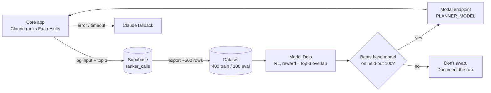

# Post-train the material ranker on Modal with Modal Dojo

## Context and problem statement

Rei finds learning materials for a skill with Exa and has to pick the few that matter. Claude does this ranking in the core app. An earlier option (notes repo: `b-exa-plus-posttrained-model.md`) planned to move one step to a post-trained open model on a rented GPU instance.

Two things changed: the team is one person, and that person has never trained a model (2026-11-13). Which platform and method should the training lane use, and which step should the model own?

## Decision drivers

- Solo builder, no training experience. Setup time is the main risk.
- The lane must be cuttable. The core product works without it.
- A narrow task the model can learn and we can measure.
- Real users must never hit a broken path.

## Considered options

1. **A rented GPU instance (Verda)**, with our own training and serving stack.
2. **Modal with Modal Dojo**, training and serving on Modal.
3. **No post-training.** Serve a base open model on Modal for one step, or skip open models.

## Decision outcome

Chosen: **option 2, Modal with Modal Dojo**, because it has the least setup for a beginner. Dojo trains from one Python config, and Modal serves behind a URL.

**What the model does:** rank materials. The input is a skill, the learner's level and goal, and 10–20 Exa candidates (title, URL, snippet, type, length). The output is JSON: the top 3 in order with a one-line reason each.

**How it learns:**

1. The core app logs every Claude ranking to Supabase. Those logs are the labels, so the dataset builds itself from M1 onward.
2. Export about 500 rankings. Hold out 100 for eval.
3. Train with Dojo's RL recipe. The reward is the overlap between the model's top 3 and Claude's top 3, plus a bonus for valid JSON. Dojo's quickstart already uses a custom reward function this way (Dojo docs, 2026-11-13).
4. Serve on Modal. The planner step reads `PLANNER_MODEL`. Any error or timeout falls back to Claude.

**Model:**

- **Default: Qwen3.5-4B.** It's the model in Dojo's documented quickstart (`Qwen3_5_4B`, `Qwen3_5_4B_Recipe`), so it's the shortest path.
- **Upgrade: Gemma-4-26B-A4B-it.** It's the only Gemma model in Dojo's list. It's a larger MoE model and the docs don't show a recipe for it. Use it only once it's confirmed to work for this setup.

### Consequences

- Good: one platform, one SDK, no GPU box to manage.
- Good: the dataset comes from real usage, not a separate generation script.
- Bad: Dojo is a young library (0.1.x). SFT, LoRA and adapter export aren't in the docs we read. We use the RL path the docs do show.

### Confirmation

- No training run started in time → drop the lane and keep Claude ranking.
- The fine-tune doesn't beat base Qwen or Gemma on top-3 overlap → don't swap. Keep the eval table as a record.
- **Eval number:** top-3 overlap with Claude for the base model, the fine-tune and Claude itself, on the same 100 held-out sets.

## Pros and cons of the options

### 1. Rented GPU instance

- Good: full control of the stack.
- Bad: drivers, CUDA, SSH, training script and serving all by hand. Too much for a first training run done alone.

### 2. Modal with Modal Dojo

- Good: plain Python, and `modal deploy` gives a public URL.
- Bad: Dojo docs are thin beyond the quickstart.

### 3. No post-training

- Good: zero risk.
- Bad: nothing to show for how the model improved.
- Kept as the fallback if the training lane is dropped.

## Update (2026-11-14)

Under option G ([ADR-0004](0004-browser-extension-local-scoring-in-app-nudges.md)), the Modal lane is a **stretch goal, done only if time allows**. The preferred target changes from the material ranker to the **local scorer**: fine-tune Gemma on Modal to answer the typed questions better, using synthetic prompts labelled by Claude and never user prompts. The ranker served as a Modal endpoint stays as the fallback. Kill rules are in the notes repo (`implementation-plan.md`).

## More information

- [Modal Dojo docs](https://dojo.modal.dev/) and [repo](https://github.com/modal-projects/modal-dojo): RL post-training, supported model list (checked 2026-11-13).
- [Modal's training example](https://modal.com/docs/examples/unsloth_finetune) (now a Dojo quickstart).
- **Open questions:**
  - Does Dojo support SFT or LoRA, or only RL?
  - Can Gemma-4-26B-A4B-it be trained within our budget, and on which GPU?
  - How do we serve a Dojo checkpoint (vLLM on Modal? Spindle?)
