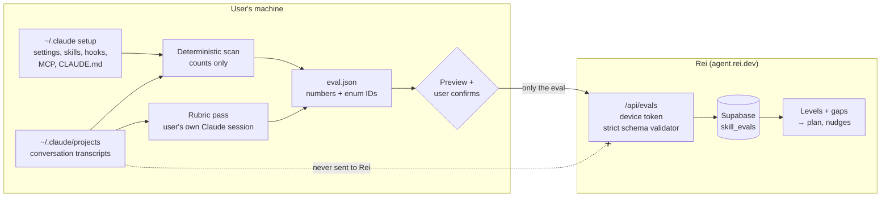

---

status: accepted
date: 2026-11-13
decision-makers: Andrei
---

# Local skill check: analyze the user's setup and Claude conversations on their machine, send only evals

## Context and problem statement

A CV says little about how someone actually builds with agents. The best evidence is on their machine: their Claude Code setup (skills, hooks, MCP servers, CLAUDE.md files, plugins) and their conversations with Claude. Rei wants to use that to rate skills and keep the plan current. Conversations hold code, company secrets and personal details, so they must never reach Rei's servers. Where does the analysis run, and what crosses the wire?

## Decision drivers

- **Hard rule: conversations never reach Rei's servers.** Only evals do (2026-11-13).
- The user must be able to see exactly what's sent before it's sent.
- Solo builder. Reuse what's on the user's machine.
- Results must map onto the skill areas from [ADR-0002](0002-one-learning-track-agentic-product-builder.md).

## Considered options

1. **Upload transcripts and analyze on the server.**
2. **A local CLI that calls the Claude API** with the user's own API key.
3. **A Claude Code plugin** (`/rei-check`): a deterministic scan of the setup plus a rubric pass over recent conversations run by the user's own Claude Code session. Only a JSON eval is uploaded.
4. **A local open model** (e.g. via Ollama) does the analysis.

## Decision outcome

Chosen: **option 3, a Claude Code plugin.** The conversations are already in the user's Claude Code, the user's own Claude can read them, and nothing new needs installing besides the plugin.

**Be exact about the privacy claim.** In option 3, transcript content goes through the user's own Claude session, so it's processed by Anthropic under the user's existing account, the same as any Claude Code use. **Rei's servers never see it.** The pitch and privacy notice say "never leaves for Rei", not "never leaves your machine".

**What the check reads (locally):**

- **Setup scan (deterministic, no LLM):** `~/.claude/settings.json` (hooks, permissions), installed plugins and skills, MCP server count, CLAUDE.md files in recent projects (present, size), subagent definitions.
- **Usage signals from `~/.claude/projects/**/*.jsonl`:** counted, not read for content. Tool calls by type, plan mode, subagent runs, test commands, how often context fills up.
- **Rubric pass (LLM, local session):** the user's Claude reads a sample of recent sessions and scores each skill area against a fixed rubric (level 0–4 and a confidence).

**What gets uploaded:** one JSON eval with a strict schema.

```json
{
  "schema": "rei.eval.v1",
  "track": "agentic-product-builder",
  "checked_at": "2026-11-14T10:00:00Z",
  "areas": [
    {
      "id": "evals",
      "level": 1,
      "confidence": 0.7,
      "signals": { "test_runs_per_session": 0.4 }
    },
    {
      "id": "context-engineering",
      "level": 3,
      "confidence": 0.8,
      "signals": { "claude_md_files": 6 }
    }
  ],
  "setup": { "hooks": 2, "skills": 14, "mcp_servers": 5, "subagents": 3 }
}
```

- **Numbers and enum IDs only.** No free text, paths, project names, MCP server names, or quotes. The server's validator rejects unknown keys and any string that isn't an allowed enum value.
- **Preview first.** `/rei-check` prints the exact payload and asks before sending. `--dry-run` writes it to `~/.rei/eval.json` and stops.
- **Auth:** "Connect Claude Code" in the app shows a one-time code. The plugin trades it for a device token tied to the Clerk user, stored in `~/.rei/`. It can be revoked in the app.
- **Open source:** the plugin is public so anyone can check what it reads and sends.



### Consequences

- Good: real evidence of how someone builds, not a self-rating or a CV. This is Rei's strongest differentiator.
- Good: re-running the check shows progress over time ("evals: 1 → 2 since last week"), and that's what keeps the plan current.
- Good: little server code. The plugin does the heavy work on the user's side.
- Bad: only works for Claude Code users. Everyone else uses the CV/profile path (M2). claude.ai chats aren't stored locally. Importing a claude.ai data export is a later option.
- Bad: rubric scores from an LLM are noisy. Show confidence, and let the user correct a level.
- Bad: the rubric pass uses the user's own Claude usage. Keep the sample small (e.g. the last 10 sessions, capped size).
- Bad: a plugin can be modified, so the server can't prove the eval is honest. That's fine: it only affects the user's own plan.

### Confirmation

- A test payload with a free-text field, a path, or an unknown key is rejected by `/api/evals`.
- Grep the Supabase tables and request logs after a real check: no transcript text, file paths or project names.
- Two different real setups give different levels on at least 3 skill areas.

## Pros and cons of the options

### 1. Upload transcripts

- Good: easiest to build and iterate on.
- Bad: breaks the hard rule. Huge liability. Rejected.

### 2. Local CLI with the user's API key

- Good: works without Claude Code.
- Bad: users need an API key and pay per token. Another install. Most target users already have Claude Code.

### 3. Claude Code plugin

- Good: no new install beyond the plugin, no API key, and it meets users where they build.
- Bad: Claude Code users only. Transcript content goes through Anthropic, as normal Claude Code use already does.

### 4. Local open model

- Good: the strongest privacy story. Nothing leaves the machine at all.
- Bad: a big download, slow on laptops, weaker scoring. Too much for the MVP. Possible later as a "fully offline" mode.

## More information

- Skill areas: [ADR-0002](0002-one-learning-track-agentic-product-builder.md).
- Open: exact rubric per skill area. Draft it with the seed skill map in M1.
- Open: the Claude Code plugin format and the transcript location (`~/.claude/projects/`) should be checked against the current Claude Code docs before building.
