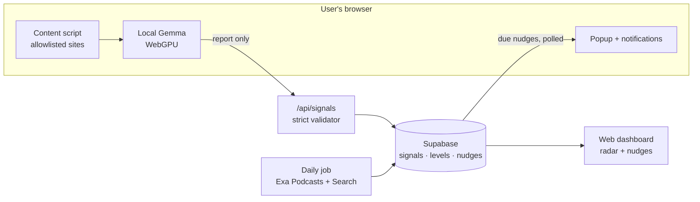

---

status: accepted
date: 2026-11-13
decision-makers: Andrei
---

# Browser extension with local scoring as the main skill input, and in-app nudges instead of Telegram

## Context and problem statement

Rei needs real evidence of how someone builds products. A CV is weak evidence, and the Claude Code plugin ([ADR-0003](0003-local-skill-check-evals-only.md)) only reaches terminal users. Most product builders work in browser tools like Lovable, Replit, v0, Bolt, Claude and ChatGPT, and what they type there shows their product skill. The prompt text is private and must never reach Rei. The stack also has to shrink for one person, and Telegram adds a bot, chat linking, a webhook and a sender. Where do we capture skill signals, where do we score them, and how do nudges reach the user?

## Decision drivers

- **Hard rule: prompt text never reaches Rei's servers.** Only typed reports do (2026-11-13).
- Strangers must be able to install and use it without our help (notes repo: `requirements.md`).
- No paid accounts beyond what we already pay for.
- Solo builder. Fewer moving parts.

## Considered options

1. **Mac menu bar app** reading text fields through the Accessibility API, with a local model.
2. **Chrome extension** on an allowlist of builder sites, with a local model in the browser.
3. **Chrome extension with a cloud scorer** (TypeSafe Jev or Claude).
4. **Keep only the Claude Code plugin** (ADR-0003) and the CV path.

For nudges:

- a. **Telegram** (current plan).
- b. **In-app:** extension popup, Chrome notifications and a list on the web dashboard.

## Decision outcome

Chosen: **option 2, a Chrome extension with local scoring, and nudges option b, in-app.** It reaches the tools most builders use, anyone can install it for free, and the privacy rule holds because the model runs on the device.

**Capture:**

- A content script on an allowlist only: `lovable.dev`, `replit.com`, `v0.app`, `bolt.new`, `claude.ai`, `chatgpt.com`. Host permissions list those domains, never `<all_urls>`.
- It reads the field's text when a prompt is submitted (Enter or the send button). It works the same for typed and dictated text.
- It never reads password or payment fields. Pause and per-site toggles in the popup.

**Scoring:**

- A small Gemma model runs in the extension with WebGPU. It answers ~30 typed questions per prompt, each with fixed answers and a probability (the "System One" pattern, done locally).
- The text is dropped after scoring. Only a `rei.signal.v1` report is uploaded: enum IDs, answers, probabilities, the hour and a length bucket. No free text. Details and the draft questions are in g-browser-skill-meter.md (notes repo: `g-browser-skill-meter.md`).
- `/api/signals` uses the same strict validator rule as ADR-0003: unknown keys and non-enum strings are rejected.
- **This reverses one part of ADR-0003.** ADR-0003 rejected a local open model as too much for the MVP. For browser prompts there's no user-owned Claude session to do the scoring, and a cloud scorer would break the hard rule. So the local model is now required. The Claude Code plugin from ADR-0003 stays as a second input.

**Connect:** the extension opens `agent.rei.dev/connect`. The signed-in page sends a device token to the extension (`externally_connectable`). It can be revoked in the app.

**Nudges:**

- Each nudge is a row in a `nudges` table. The extension checks for due nudges every 15 minutes (`chrome.alarms`) and shows a Chrome notification. The popup and the web dashboard show the same list.
- **Done**, **Skip** and **Too basic** are buttons in all three places.
- Telegram, WhatsApp, chat linking, the inbound webhook and the message-sending cron are removed. One daily job stays: the Exa scan for new podcast segments and practices.

**Distribution:** Chrome Web Store, with a one-time $5 developer fee (Chromium blog; third-party guides 2026). Review time isn't guaranteed: a community post reported slower reviews in April 2026, and Google says broad host permissions get deeper review. Until approval, users install with "Load unpacked" from the GitHub zip.

### Consequences

- Good: covers the tools most product builders use, not only Claude Code.
- Good: free for everyone to install, and anyone can try it with their own prompts.
- Good: a smaller stack. No bot, no chat linking, no message webhook, no WhatsApp track.
- Good: private, on-device skill scoring.
- Bad: browser only. Desktop apps (Cursor, the Claude desktop app) aren't covered. The Mac app stays a later option, and needs a paid Apple account for others to install it.
- Bad: nudges reach users only when they're at the browser. That's weaker for retention. Email or Telegram can come back later.
- Bad: on-device scoring in WebGPU is the biggest technical risk: download size, speed, and laptops without WebGPU.
- Bad: each site's prompt box is different, and rich editors may need small per-site adapters.
- Bad: the extension can be modified, so the server can't prove a report is honest. That's fine: it only affects the user's own levels.

### Confirmation

- The content script reads the submitted prompt on at least 3 allowlisted sites.
- Gemma in WebGPU scores a prompt in under ~3 s on a normal laptop. If not, use a deterministic local scorer for the MVP. Still local, never a silent cloud fallback.
- A test report with free text, an unknown key or a non-enum string is rejected by `/api/signals`.
- After a real session, grep Supabase and the request logs: no prompt text.
- A stranger installs the extension, prompts, and gets a nudge without our help.

## Pros and cons of the options

### 1. Mac menu bar app

- Good: sees every app, including desktop tools.
- Bad: others can't install it without warnings unless we pay $99/year for notarization. Accessibility reading of browser and Electron fields is inconsistent. Native code and permissions take time.

### 2. Chrome extension, local model

- Good: free to install, covers the main builder tools, keeps the privacy rule.
- Bad: browser only. WebGPU model risk.

### 3. Chrome extension, cloud scorer

- Good: simplest and fastest scoring. Jev is reported at about $0.042 per million input tokens and 70–500 ms (launch coverage, 2026-11-13, not checked against TypeSafe's docs).
- Bad: prompt text goes to a third party. Breaks the hard rule. Possible later as a clearly labelled opt-in.

### 4. Claude Code plugin only

- Good: already planned, no new surface.
- Bad: terminal users only. Misses most product builders.

### a. Telegram nudges

- Good: reaches the user's phone.
- Bad: a bot, deep-link linking, an inbound webhook and a sender. Extra work for one person.

### b. In-app nudges

- Good: one `nudges` table, read by the extension and the dashboard. No extra services.
- Bad: only reaches users at their browser.

## Update (2026-11-14)

- The site allowlist is now `claude.ai` and `chatgpt.com` only. See [ADR-0008](0008-extension-runs-on-claude-and-chatgpt-only.md).
- The report is now `triplekeel.signal.v1`, not `rei.signal.v1`. Its exact shape is in [ADR-0010](0010-report-schema-signal-v1.md).
- The MVP scorer is keyword rules, not Gemma ([ADR-0012](0012-keyword-scorer-for-the-mvp.md)). Both fit behind the scorer interface in [ADR-0011](0011-scorer-interface-stub-first-on-device-routing.md).

## More information

- Option file: g-browser-skill-meter.md (notes repo: `g-browser-skill-meter.md`).
- Updates requirements.md (notes repo: `requirements.md`) §4 (messaging) and §8 (local check), and implementation-plan.md (notes repo: `implementation-plan.md`) (rewritten for option G on 2026-11-14).
- Sources: [Chrome Web Store review process](https://developer.chrome.com/docs/webstore/review-process), [PSA: increase in review times (Chromium Extensions group, April 2026)](https://groups.google.com/a/chromium.org/g/chromium-extensions/c/VJ6DcpEn51Y), [Hatchworks on Jev](https://hatchworks.com/blog/gen-ai/system-one-models-jev/), [InfoQ on Jev](https://infoq.com/news/2026/10/typesafe-ai-jev-released).
- Open: check Google's August 2026 post on review times and publication limits before submitting.
